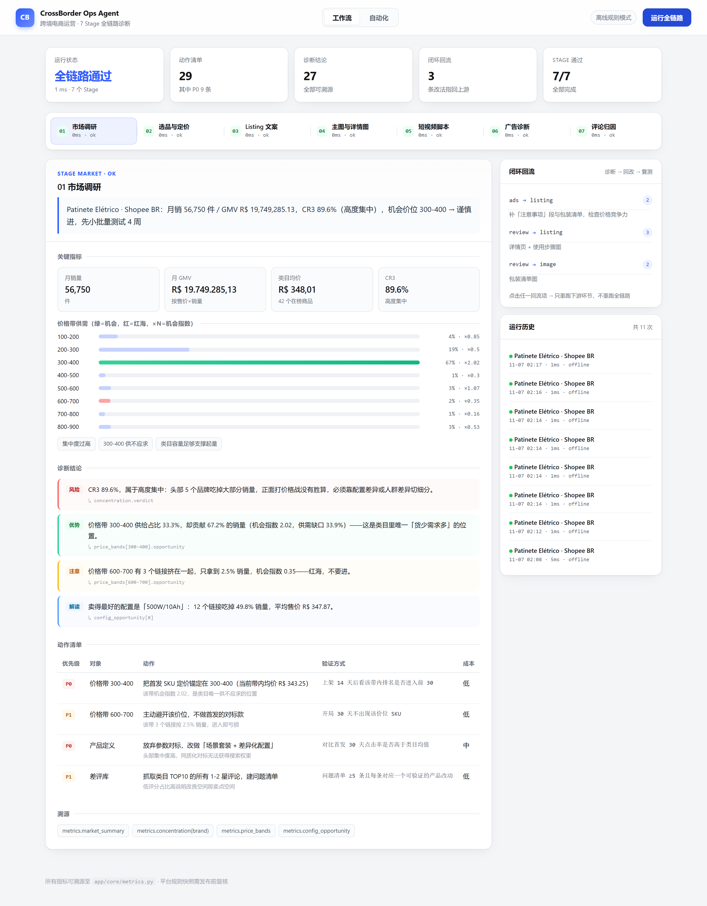
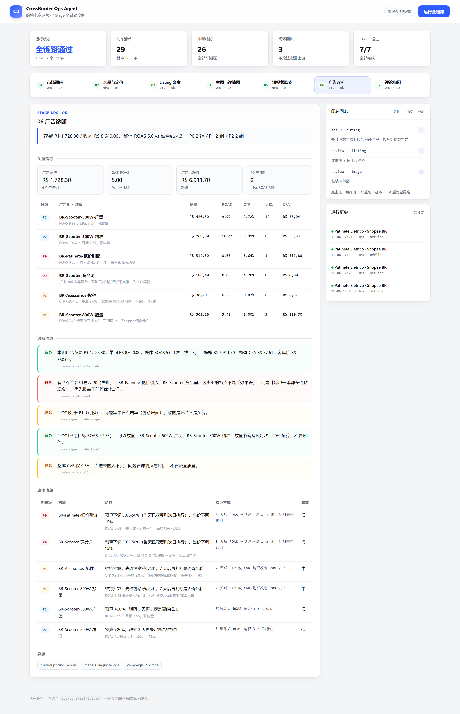
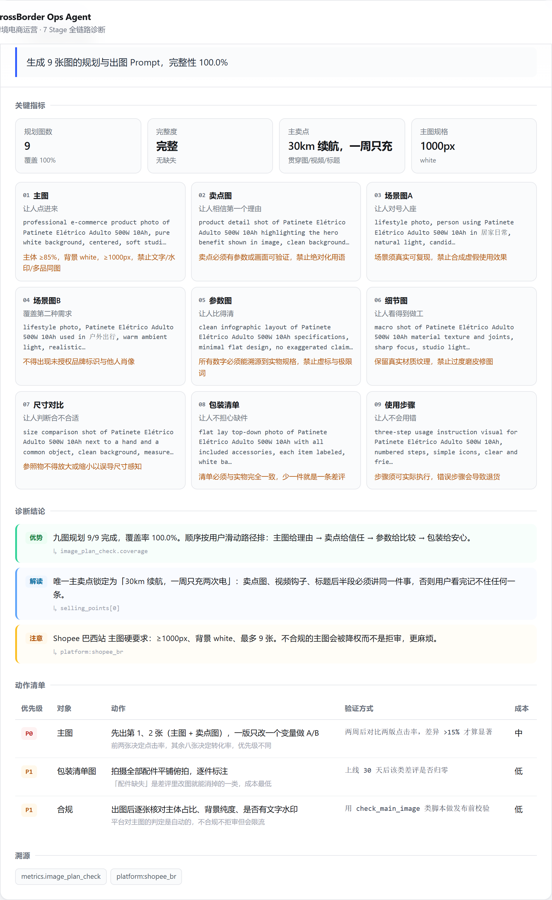
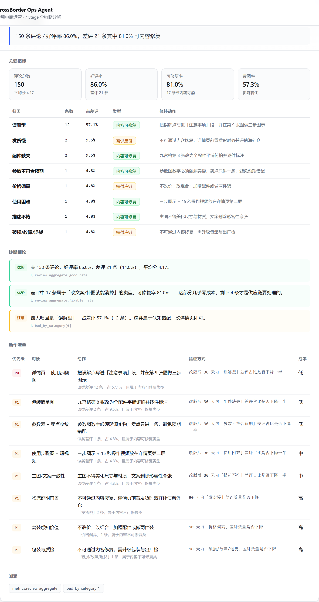
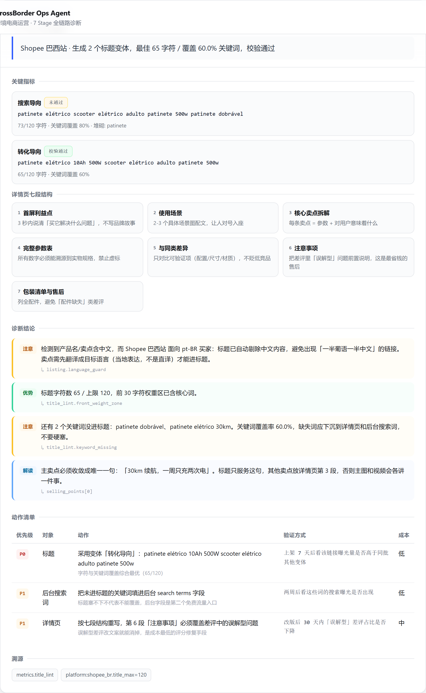

# CrossBorder Ops Agent

**跨境电商运营多 Agent 系统** —— 把「这个类目能不能做」「这个价格能不能打」「这条广告该不该停」变成一条可执行、可追溯、可复测的流水线。

7 个 Stage 覆盖从选品到复盘的全链路，所有数字由确定性脚本计算，Agent 只负责解读和给动作。
支持**定时自动执行**与**跨运行闭环对比**：每天跑一次，自动告诉你上次的动作有没有让指标变好。



---

## 它解决什么问题

跨境运营的日常不是「不知道要做什么」，而是**判断没有统一口径**：

- 同一个类目，老运营看价格带供需比就知道能不能进，新人只能看谁卖得最好然后跟着卷；
- 广告亏钱时，有人先降价、有人先改图、有人直接关掉，三种动作对应三种后果，但没人算过盈亏线；
- 差评多了就说「要改产品」，其实 80% 的差评改一段文案就能消掉，剩下 20% 才是工厂的事。

这套系统做的事情，是**把老运营的判断规则固化成可计算的流程**，并且强制要求每一次判断都能指回具体数字。

---

## 快速开始

```bash
python -m venv .venv
.venv\Scripts\activate           # Windows
pip install -r requirements.txt

python scripts/gen_seed.py       # 生成演示数据（确定性，每次一样）
python run.py                    # 打开 http://127.0.0.1:8000
```

不想开浏览器也可以直接看命令行报告：

```bash
python scripts/demo_run.py
```

**不需要任何 API Key。** 默认跑「离线规则模式」，全链路完整可用。要接大模型时复制 `.env.example` 为 `.env`，配置 `ECOM_LLM_PROVIDER=dashscope` + `DASHSCOPE_API_KEY`。

用 Docker 起（含鉴权、日志、数据卷）：

```bash
cp .env.example .env      # 填 ECOM_API_TOKEN 即可开启鉴权
docker compose up -d
```

---

## 七个 Stage

| # | Stage | 回答的问题 | 关键输出 |
|---|---|---|---|
| 01 | 市场调研 | 这个类目该不该进，从哪个价位切 | 容量、CR3/CR10/HHI、价格带机会指数、进入评分 |
| 02 | 选品与定价 | 这个价格卖一件能赚多少 | 净利率、盈亏线 ROAS、可承受 CPC、SKU 四角色 |
| 03 | Listing 文案 | 标题能不能被搜到 | 三套变体、字符实测、关键词覆盖、堆砌检测 |
| 04 | 主图与详情图 | 九张图各自要解决什么疑虑 | 九宫格规划、出图 Prompt、逐格合规要求 |
| 05 | 短视频脚本 | 25 秒怎么讲清一件事 | 四段分镜、口播稿、时长与语速校验 |
| 06 | 广告诊断 | 哪条广告在失血，先动哪里 | P0/P1/P2 分级、动作清单、回流指令 |
| 07 | 评论归因 | 差评里哪些改文案就能消掉 | 八类归因、可修复率、修补动作 |

### 闭环是这套系统和「一次性生成工具」的分界线

```
01 市场 ──► 02 策略 ──► 03/04/05 素材 ──► 上架
                                          │
                        06 广告诊断 ─┐    │
                        07 评论诊断 ─┴────┴──► 回流 03/04 修正 ──► 复测
```

06 和 07 的结论会生成 **feedback 指回上游环节**（广告 CTR 低 → 回 03/04 改创意；评论误解型多 → 回 03 补注意事项段）。界面里点击回流项，只重跑被影响的环节，不重跑全链路。

---

## 数据接入：把卖家的 CSV 喂进来

真实痛点不是解析，是**列名对不齐**。同一个字段，Shopee 后台叫「曝光量」，Amazon 报表叫 `impressions`，ERP 导出叫「展示次数」，还带单位后缀「花费(BRL)」。

上传时会自动处理三件事：

| 问题 | 处理 |
|---|---|
| 中文 Excel 导出是 GBK | 依次尝试 UTF-8 / GBK / GB18030 |
| 列名千奇百怪 | 中英别名模糊匹配，去空格、去括号、大小写不敏感 |
| 数字格式混乱 | `R$ 420,50`、`1.234,56`、`1,234.56` 都能正确解析 |

解析结果会明确告诉你**哪个字段匹配到了哪一列、哪些列被忽略、哪些行被跳过**：

```json
{
  "mapping": {"广告组": "广告名称", "曝光": "曝光量", "花费": "花费(BRL)"},
  "row_count": 3,
  "skipped": 0,
  "ignored_columns": []
}
```

缺必填列时不会只说「格式错误」，而是：「缺少必填列：点击、花费。当前表头：广告名称、曝光量…」

界面上传后会生成数据集，填几个表格里没有的参数（成本、售价、产品名），一键跑。

---

## 阈值配置：同一份数据，不同平台结论不同

「CTR 低于 2% 就是创意问题」这句话对 Shopee 成立，对 Amazon 完全不成立 —— Amazon 的广告 CTR 普遍在 0.4% 上下，用 2% 去卡会把**所有正常广告判成失败**。

所以 20 个判断参数全部可配，界面上直接改，每项标注来源：

| 来源 | 含义 |
|---|---|
| 系统默认 | 兜底值 |
| 平台预设 | 按平台差异配置（Amazon 0.4% / Shopee 2.5% / TikTok 3.0%） |
| 界面设置 | 你自己改过的 |
| 请求参数 | 单次运行临时覆盖 |

优先级：**请求 > 界面设置 > 平台预设 > 系统默认**。

实测效果 —— 同一个配件广告组：

```
CTR 基准 2.5%  → click_through   「CTR 不达标，是创意问题」
CTR 基准 0.5%  → below_target    「CTR 过了，是 ROAS 未达标」
```

**换个阈值，诊断结论就从「改图」变成「调出价」。** 这就是为什么阈值不能写死。

越界值会被拒绝并回滚（比如把 CTR 基准填成 99%，等于废掉整个分级逻辑）。

---

## 评论自动归因：把「人工打标」换成「机器分好、人只抽查」

真实导出的评论表只有**评分和正文**，没有分类列。以前要人工一条条打标，这是整个流程里最耗人的环节。

现在评论直接进来就能归因，**规则优先、模型兜底**：

```
关键词规则（中/英/葡三语）  →  覆盖高频表达，确定、免费、毫秒级
      ↓ 没命中
模型批量分类（20 条/次）    →  覆盖长尾表达
      ↓ 还是分不出
标记「待人工确认」          →  不计入归因、不生成动作
```

最后这条是刻意的：**猜错分类比不分类更糟**，它会让你去改一个不存在的问题。

### 实测效果

拿种子数据的人工标注当标准答案，抹掉分类列让系统重分：

| 指标 | 数值 |
|---|---|
| 覆盖率 | 100%（21 条差评全部分完，129 条好评正确跳过） |
| 准确率 | 90.5% |
| 首版准确率 | 50% → 修了「语义反转」问题后升到 90.5% |

评估脚本可以自己跑：

```bash
python scripts/eval_classify.py          # 只用规则
python scripts/eval_classify.py --llm    # 规则 + 模型
```

### 最难的一类：语义反转

```
"A bateria durou menos do que eu esperava"
```

字面命中「电池」，但它实际在说「**我的预期错了**」——这是误解型，不是参数不符。

两者的补救动作完全相反：误解型改详情页，参数不符要改产品。所以规则里加了**强信号词**（esperava / achei que / 我以为 / thought it），一旦命中直接锁定类别，不再看其他关键词。

> 首版准确率只有 50%，10 条错分全是这个原因。

---

## 多人协作：多租户 + 权限分级

### 三个角色，权限差异有业务含义

| 权限 | 负责人 | 运营 | 只读 |
|---|---|---|---|
| 查看运行记录、报告 | ✅ | ✅ | ✅ |
| 跑诊断、传数据 | ✅ | ✅ | ❌ |
| 改**内容类**阈值（词频上限、语速） | ✅ | ✅ | ❌ |
| 改**核心**阈值（CTR 基准、集中度线） | ✅ | ❌ | ❌ |
| 删数据、管理成员、审批 P0 动作 | ✅ | ❌ | ❌ |

**为什么这么分**：改 CTR 基准意味着「以后哪些广告算失败」，会直接改变止血动作，必须负责人拍板；改标题字符上限只影响产出形态，运营自己就能调。

### 店铺隔离

每个店铺的数据、阈值、运行记录、定时任务互相独立：

- A 店把 CTR 基准调到 5%，B 店不受影响
- A 店的运行记录不会成为 B 店闭环对比的基线（这条最容易出 bug）
- 靠猜 dataset id 也读不到别家数据

### 开箱即用 vs 不能裸奔

```
系统里没有用户  →  开放模式，匿名视为负责人，clone 下来直接能用
创建第一个用户  →  强制登录，/api 全部 401
```

这条规则让「本地跑起来试试」和「部署后不能裸奔」共存。初始化时创建的第一个账号就是负责人。

---

## 安全与运维

| 项 | 说明 |
|---|---|
| **鉴权** | 设置 `ECOM_API_TOKEN` 后，所有 `/api` 需要 `X-API-Token` 或 `Bearer`；不设则开放（本机演示） |
| **日志** | 控制台 + `data/logs/app.log`（5MB×3 滚动），每个请求带 `X-Request-ID`，401 也记 |
| **CORS** | 默认 `*`（本机开发）；`ECOM_CORS_ORIGINS` 可收紧到具体域名 |
| **部署** | `Dockerfile` + `docker-compose.yml`，带 healthcheck，数据卷挂 `./data` |
| **上传限制** | 单文件 10MB、最多 5 万行 |

---

## 自动化：定时执行 + 闭环优化

除了点一下跑一次，系统还能自己跑，并且**记住上次说了什么、这次有没有变好**。

### 定时执行

内置一个轻量调度器（一条后台线程 + 自己写的 cron 解析，没引调度框架）：

```
*/10 * * * *     每 10 分钟
0 9 * * *        每天 09:00
0 9 * * 1        每周一 09:00
0 0 1 * *        每月 1 号
```

界面里可以直接建任务、启停、立即执行一次验证配置。到点后自动跑全链路，运行记录标记为 `trigger=scheduler`。

### 闭环优化

每次运行结束，自动与上一次对比（同任务优先），产出三样东西：

| 产物 | 例子 |
|---|---|
| 指标对比 | ROAS 5.0 → 8.06 ↑、P0 失血组 2 → 0 ↓，逐项标注改善/恶化 |
| 遗留动作 | 上次的 9 条 P0 里，3 条已消除、6 条仍在 —— **在说明动作没执行或没生效** |
| 整体判定 | 改善 / 恶化 / 持平，附判定依据 |

跑一遍三轮回环演示就能看到完整效果：

```bash
python scripts/demo_cycle.py
```

```
第 1 轮 · 基线诊断        闭环判定：首次运行
第 2 轮 · 关停失血组+修文案  闭环判定：改善   6 项转好，0 项转差
                          ROAS 5.0 → 8.06 ↑   P0 组 2 → 0 ↓
                          已消除：BR-Patinete-低价引流、BR-Scooter-竞品词
第 3 轮 · 新开一组但素材没跟上 闭环判定：恶化   ROAS 8.06 → 7.05 ↓
```

**这里不做的事**：不自动改价、不自动停广告。那些动作需要人审批。
自动化只负责两件事：**按时把诊断跑出来**，以及**如实告诉人「上次让你改的，你到底改了没有」**。


### 界面预览

| 广告诊断（分级 + 动作） | 主图九宫格（含合规要求） |
|---|---|
|  |  |

| 评论归因（可修复率） | Listing（字符实测） |
|---|---|
|  |  |


---

## 四条设计原则

### 1. 能算的不让模型猜

`app/core/metrics.py` 是**全系统唯一允许产生数字的地方**。Agent 无论用什么模型，都必须先拿这里的输出，再写解读。

这不是保守，是必需：广告诊断要能回归测试，同一份报表跑两次必须得出同一个 P0 清单。让模型算数就做不到。

### 2. 缺字段直接阻塞

每个 Stage 声明必填字段，缺了就返回 `status=blocked` + `missing` 列表，绝不填默认值。

```
[STOP] 05 短视频脚本
       [INPUT_MISSING] 缺少 1 个必填字段，已停止计算（不猜数据）
       缺失字段: main_point
```

模型最危险的失败模式不是「不会写」，而是「缺数据时编一个像样的」。把缺字段变成硬阻塞，幻觉就没有发生的位置。

### 3. 诊断顺序不可跳步

广告分级固定为：数据充分性 → 有无花费 → CTR → 零单 → ROAS 分级。

顺序错了会把噪声当结论：一个曝光只有 500 的组 ROAS 再低也不该动，一个 CTR 1% 的组订单为零的根因是创意而不是出价。先排除假问题，再处理真问题。

### 4. 每条动作必须带验证方式

```
[P0] BR-Patinete-低价引流 → 预算下调 30%-50%，出价下调 15%
     验证：3 天后 ROAS 回到盈亏线以上；未回到则关停该组
```

没有验证方式的动作清单等于没有清单 —— 做完不知道有没有用，下次还是拍脑袋。

---

## 架构

```
┌──────────────────────────────────────────────┐
│  单页前端  ·  流水线看板 / 指标 / 动作 / 回流   │
└───────────────────┬──────────────────────────┘
                    │ REST
┌───────────────────▼──────────────────────────┐
│  FastAPI 路由层                               │
├──────────────────────────────────────────────┤
│  编排器  ·  DAG 执行 / 输出继承 / 闭环回流      │
├──────────────────────────────────────────────┤
│  7 个 Stage Agent  ·  契约化 I/O / 动作 / 回流 │
├──────────────────────────────────────────────┤
│  确定性计算层  ·  指标 / 定价 / 分级 / 归因     │
├──────────────────────────────────────────────┤
│  SQLite  ·  运行记录可复现                     │
└──────────────────────────────────────────────┘
```

详细设计取舍见 [ARCHITECTURE.md](ARCHITECTURE.md)，包含开发过程中被自己的校验器抓出来的四个真实缺陷。

---

## 目录

```
app/
├── core/
│   ├── metrics.py      # 确定性计算（唯一产生数字的地方）
│   ├── contracts.py    # Stage 契约 + INPUT_MISSING
│   ├── platforms.py    # 平台规则卡（标题上限/费率/图片规格）
│   ├── auth.py         # 用户/会话/角色权限
│   ├── review_classify.py  # 评论自动归因（规则 + 模型兜底）
│   ├── config.py       # 阈值配置（四层优先级 + 平台预设）
│   ├── cron.py         # 最小 cron 解析（无第三方依赖）
│   ├── cycle.py        # 闭环对比：指标快照 / 遗留动作 / 改善判定
│   └── llm.py          # LLM 可选接入，默认离线
├── agents/             # 7 个 Stage
├── orchestrator.py     # DAG + 回流 + 每次运行自动做闭环对比
├── scheduler.py        # 定时调度（后台线程，30 秒一次 tick）
├── api/routes.py       # REST
├── demo.py             # 演示数据装载
└── static/             # 单页前端（无构建）
data/seed/              # 确定性种子数据
tests/                  # 23 个单测
```

## API

| 方法 | 路径 | 说明 |
|---|---|---|
| POST | `/api/runs` | 跑全链路（不传 payload 用演示数据） |
| GET | `/api/runs` | 运行历史 |
| GET | `/api/runs/{id}` | 单次运行详情（含输入，可复现） |
| POST | `/api/stages/{stage}` | 单点重跑（闭环用） |
| GET | `/api/contracts` | 所有 Stage 的输入契约 |
| GET | `/api/auth/status` | 是否已初始化、有哪些店铺（免登录） |
| POST | `/api/auth/setup` | 首次初始化，创建第一个负责人 |
| POST | `/api/auth/login` | 登录（写入 HttpOnly Cookie） |
| GET | `/api/auth/me` | 当前身份与权限清单 |
| POST | `/api/auth/switch-store` | 切换当前店铺 |
| GET / POST | `/api/users` | 成员列表 / 新增成员 |
| PATCH / DELETE | `/api/users/{id}` | 改角色 / 移除成员 |
| GET / POST | `/api/stores` | 店铺列表 / 新建店铺 |
| GET | `/api/config` | 阈值清单（按平台，带来源标注） |
| PUT | `/api/config` | 修改阈值覆盖（越界拒绝） |
| POST | `/api/config/reset` | 全部恢复默认 |
| POST | `/api/datasets/upload` | 上传 CSV（multipart，kind=products/ads/reviews） |
| GET | `/api/datasets` | 已上传数据集列表 |
| DELETE | `/api/datasets/{id}` | 删除数据集 |
| POST | `/api/runs/from-datasets` | 用数据集 + 参数直接运行 |
| GET | `/api/automation/status` | 调度器状态 + 任务列表 + 下次执行倒计时 |
| POST | `/api/automation/schedules` | 新建定时任务（cron + payload） |
| PATCH | `/api/automation/schedules/{id}` | 启用 / 暂停 |
| POST | `/api/automation/schedules/{id}/run` | 立即执行一次 |
| DELETE | `/api/automation/schedules/{id}` | 删除任务 |
| POST | `/api/automation/tick` | 手动触发一次调度检查 |

## 测试

```bash
python -m unittest discover -s tests -v
```

90 个用例，覆盖：盈亏线 ROAS 与净利率互逆、CR10 在品牌数不足时的降级、广告诊断顺序、可修复率口径、堆砌检测、契约阻塞、以及「同一输入两次运行结论逐字一致」。

## 已知限制

- **不代执行**：不操作卖家后台、不自动改价改预算，动作清单交人审批
- **会话存在服务端单表**：没有 Redis，多实例部署需要共享会话存储
- **平台预设是经验值**：`config.py` 里的平台差异按公开资料估算，真实使用前应该用自己账号的数据校准
- **不采数据**：类目/广告/评论导出由使用者提供，系统不做爬虫
- **不出图不出片**：产出规划与 Prompt，渲染交给生图/剪辑工具
- **平台规则是快照**：费率、标题上限、图片规格集中在 `platforms.py`，发布前需人工复核
- **评论归因在 21 条样本上评估**：90.5% 准确率来自种子数据，真实类目需要重新校准规则
- **离线模式的创意是模板**：接 LLM 后标题与脚本质量会明显提升，但分析结论不变
- **调度器是单进程的**：uvicorn 多 worker 部署会重复触发，需要加分布式锁；当前按单 worker 设计
- **闭环对比不判断因果**：指标变好可能是季节性或投放结构变化，系统只指出相关性，不下因果结论

## License

MIT
